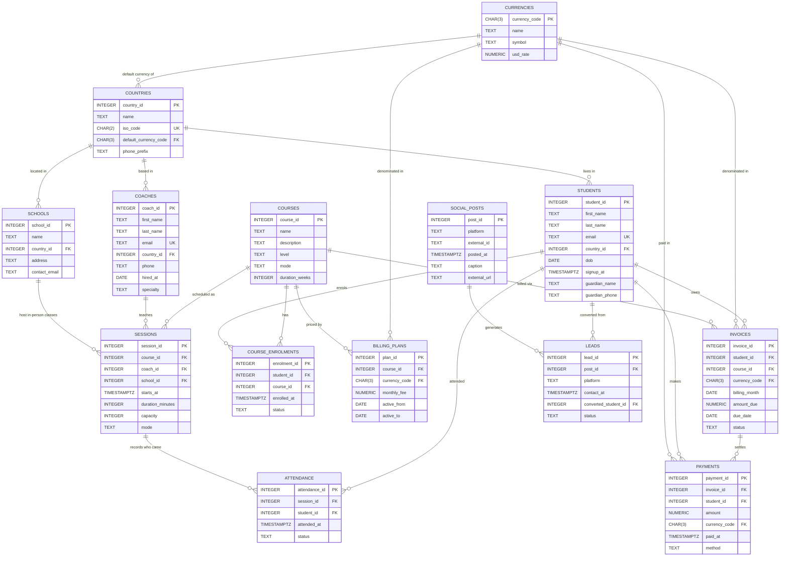

# ER Diagram — Afordchess Academy (14 tables, matches `schema.sql`)

## Limitations captured by the schema (from P1 README)

| Limitation | Enforced by |
|---|---|
| A student's email is unique | `students.email UNIQUE` (and `coaches.email UNIQUE`) |
| An in-person session must name a partner school | `sessions.chk_inperson_school` CHECK constraint |
| A session's capacity cannot be exceeded | Trigger `trg_check_capacity` (see `triggers.sql`) |
| A student can only be booked into a session for a course they are enrolled in | Trigger `trg_check_enrolment` (see `triggers.sql`) |
| A payment currency must match the invoice currency | Composite FK on `payments(invoice_id, currency_code)` → `invoices(invoice_id, currency_code)` |
